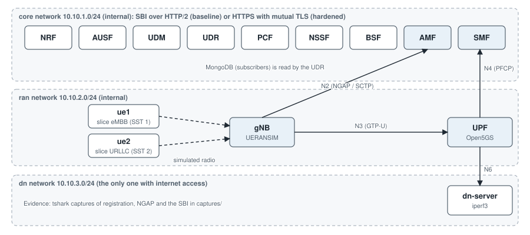
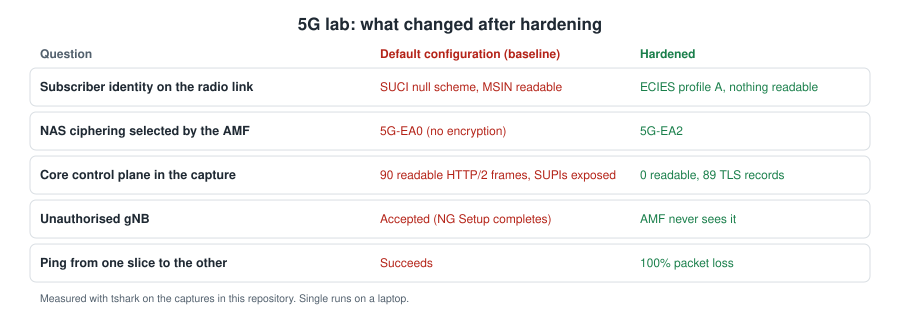

# 5G Standalone Core Lab with Security Analysis

A reproducible 5G SA network (core + simulated base station and phones) running in Docker, used to
**measure real security weaknesses of a default 5G deployment and verify the fixes**.

- **Core:** [Open5GS](https://open5gs.org) 2.7.2 (NRF, SCP, AMF, SMF, UPF, AUSF, UDM, UDR, PCF, BSF, NSSF)
- **RAN + UEs:** [UERANSIM](https://github.com/aligungr/UERANSIM) 3.3.0 (gNB, 2 UEs), no radio hardware, nothing is transmitted over the air
- **Analysis:** Wireshark/tshark in a container, scripted experiments, results in `results/`

## Architecture



| Network | Purpose | Internet |
|---|---|---|
| `core` 10.10.1.0/24 | SBI + PFCP between network functions | no |
| `ran` 10.10.2.0/24 | N2/N3 + simulated radio | no |
| `dn` 10.10.3.0/24 | N6 data network, iperf3 server | yes (via host) |

Two **network slices**, each with its own DNN and UE address pool: `eMBB` (SST 1, dnn `internet`, 10.45.0.0/24)
and `URLLC` (SST 2, dnn `urllc`, 10.46.0.0/24). `ue1` uses eMBB, `ue2` uses URLLC.

## Run it

Requirements: Linux, Docker with Compose v2, about 2 GB free RAM. The host kernel must be able to load
the `sctp` module (it autoloads on Ubuntu 22.04; no sudo needed).

```bash
scripts/lab.sh up baseline        # Open5GS defaults
scripts/run_experiments.sh baseline

scripts/lab.sh up hardened        # security-hardened configuration
scripts/run_experiments.sh hardened

scripts/lab.sh status             # container state + UE sessions
scripts/lab.sh down
```

Quick manual checks:

```bash
docker compose exec ue1 ping -I uesimtun0 -c 3 10.10.3.50                       # through the UPF
docker compose exec ue1 iperf3 -B <ue1 tun IP> -c 10.10.3.50 -t 5               # throughput
```

Configs are **generated** from the pristine upstream files by `scripts/gen_configs.py` into
`config/profiles/<profile>/`, so the difference between the two profiles is one readable diff:
`diff -r config/profiles/baseline config/profiles/hardened`.

## Findings (measured in this lab, see `results/` and `captures/`)



| # | Attack / weakness | Baseline (Open5GS defaults) | Hardened | How it is fixed |
|---|---|---|---|---|
| E1 | **Subscriber identity on the air interface** | UE sends SUCI with **null scheme**; the MSIN (`0000000001`) is readable in the pcap | **ECIES Profile A** (scheme 1, key id 1); no MSIN visible | UE configured with the home-network public key; UDM holds the private key |
| E1 | **NAS ciphering** | AMF selects **5G-EA0 (no encryption)** because `NEA0` is first in the preference list | AMF selects **5G-EA2** | `ciphering_order: [NEA2, NEA1]`, `integrity_order: [NIA2, NIA1]` (NEA0/NIA0 removed) |
| E2 | **Core control plane eavesdropping** | 90 readable HTTP/2 frames; **104 lines expose SUPIs** (e.g. `PUT /nudm-uecm/v1/imsi-.../registrations`, 5G-AKA confirmation) | 0 readable frames, 89 encrypted TLS records | SBI over **HTTPS with mutual TLS**, certificates signed by the lab CA |
| E3 | **Rogue gNB** | Unauthorised gNB at 10.10.2.66 completes **NG Setup** with the AMF | AMF never sees it; SCTP is dropped | AMF host firewall allows N2 only from the provisioned gNB address |
| E4 | **Slice isolation** | ue1 (eMBB) can reach ue2 (URLLC) across slices (ping succeeds) | 100% packet loss | UPF `FORWARD` DROP between the two slice subnets |

Performance is unchanged within noise (iperf3 TCP, UE to the data-network server through the UPF):

| | baseline | hardened |
|---|---|---|
| ue1 (eMBB): RTT / throughput | 0.38 ms / 754 Mbit/s | 0.86 ms / 807 Mbit/s |
| ue2 (URLLC): RTT / throughput | 0.41 ms / 557 Mbit/s | 0.64 ms / 759 Mbit/s |

Single runs on a laptop with other containers running; do not read the differences as a cost or gain of
hardening. The slices differ in addressing, DNN and isolation, **not** in enforced rate or latency.

## Repository layout

```
docker-compose.yml        the whole lab (profiles selected with PROFILE=baseline|hardened)
config/open5gs/           pristine upstream configs, keys and certs (read only)
config/profiles/<name>/   generated configs actually used
scripts/gen_configs.py    builds both profiles from upstream + a handful of explicit changes
scripts/lab.sh            up / down / status
scripts/provision.sh      inserts the two subscribers into the UDR database
scripts/capture.sh        pcap of N2 + SBI during a fresh attach
scripts/analyze_pcap.sh   tshark summary (SUCI scheme, NAS algorithms, SBI exposure)
scripts/run_experiments.sh  E1-E5 for one profile -> results/<profile>.md
captures/                 the pcaps behind the results (open them in Wireshark)
docs/threat-model.md      STRIDE threat model of the lab
```

## Limits and honest notes

- **Simulated radio.** UERANSIM models the RAN; radio-layer attacks (IMSI catchers, downgrade over the air)
  cannot be shown here. The rogue-gNB test shows the *core-side* exposure: an unauthenticated N2 endpoint.
- **N2 is protected by an allow-list, not IPsec.** An allow-list stops other hosts; it does not stop an attacker
  who can spoof the gNB address on the same segment. Production networks protect N2/N3 with IPsec.
- **SUCI concealment is a UE-side choice.** The network cannot force it: Open5GS still accepts the null scheme,
  and a real operator provisions the scheme in the SIM. The lab shows what the network sees in each case.
- **SBI without the SCP.** With TLS enabled, the SCP of Open5GS 2.7.2 stopped accepting connections in this
  lab (the accept queue filled and it logged nothing); I did not root-cause it. The hardened profile therefore uses
  3GPP *direct communication*: NFs discover each other through the NRF and connect to each other over mTLS.
  This also required deploying the NSSF, because without an SCP the AMF queries it directly.
- **Certificates are the test certificates shipped with Open5GS** (and so are the home-network keys). Never reuse
  them outside a lab.
- Lab only: run it on your own machine, never against networks or devices you do not own.
- Versions are pinned (`gradiant/open5gs:2.7.2`, `gradiant/ueransim:3.3.0`, `mongo:6.0`). UERANSIM 3.2.6 was
  tried first and has no SUCI concealment support, which is why 3.3.0 is used.

## Third-party material and licensing

The lab's own scripts, configuration generators and documentation are MIT licensed (see `LICENSE`).
The images it runs are third-party: [Open5GS](https://open5gs.org) (AGPL-3.0) and
[UERANSIM](https://github.com/aligungr/UERANSIM) (GPL-3.0). The files under `config/open5gs/tls/` and `config/open5gs/hnet/`
are the **public sample test certificates and home-network keys shipped with Open5GS**, kept so the lab runs
offline. They are not secrets and must never be used outside a lab.
